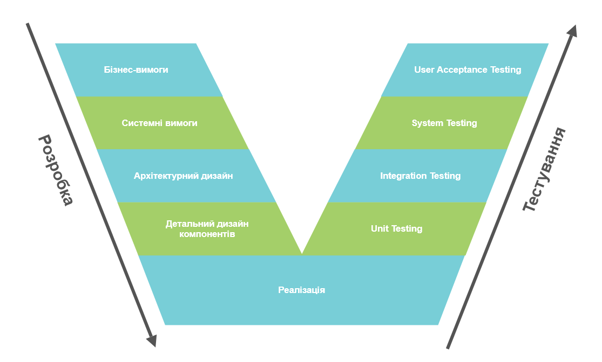

# Лабораторна робота 4

## Крок 1. Моделювання фаз каскадної моделі

| Фаза Waterfall | Вхідні артефакти                                      | Відповідальна роль          | Критерій завершення                                                                     |
| -------------- | ----------------------------------------------------- | --------------------------- | --------------------------------------------------------------------------------------- |
| Вимоги         | Візія проєкту, геймдизайн-документ                    | Lead Game Designer          | Затверджений замовником документ SRS                                                    |
| Проєктування   | Підписаний SRS                                        | Solution Architect          | Архітектурна специфікація, схема вузлів Godot та специфікація форматів збереження даних |
| Реалізація     | Архітектурний документ                                | Devs, 3D Artist             | Стабільний репозиторій та відсутністю помилок компіляції                                |
| Тестування     | Білд, тест-план                                       | QA Engineer                 | Звіт про тестування з підтвердженням відсутності критичних дефектів                     |
| Розгортання    | Перевірений релізний білд гри, інструкції користувача | Project Manager / Publisher | Публікація дистрибутива на itch.io, Steam                                               |

## Крок 2. Формування Product Backlog

| Ліва гілка / Розробка                  | Опис                                                                                                                                                                                                                                                                                                                                   |     | Права гілка / Тестування           | Що перевіряється                                                                                                       |
| -------------------------------------- | -------------------------------------------------------------------------------------------------------------------------------------------------------------------------------------------------------------------------------------------------------------------------------------------------------------------------------------- | --- | ---------------------------------- | ---------------------------------------------------------------------------------------------------------------------- |
| Рівень 1: Бізнес-вимоги                | Цілі проєкту, цільовий FPS (60+), ігровий цикл                                                                                                                                                                                                                                                                                         |     | User Acceptance Testing (UAT)      | Чи забезпечує гра заявлений ігровий процес, чутливість управління та комфортну частоту кадрів для користувача          |
| Рівень 2: Системні вимоги (SRS)        | Ініціалізація ігрової сесії, процедурна генерація, управління персонажем, мета-прогресія, динамічне завантаження, бойова система, штучний інтелект ворогів, налаштування гравців, збереження прогресу та конфігурації;  Оптимізація при генерації, стабільність ігрового процесу, час завантаження, надійність, масштабованість. |     | System Testing (Системне)          | Стабільність процедурної генерації, відсутність витоків пам'яті, продуктивність шейдерів та надійність збережень       |
| Рівень 3: Архітектурний дизайн         | Взаємодія модулів: `LevelManager`, `RandomWalker`, `PlayerData` та сигнальна система C# та Godot                                                                                                                                                                                                                                       |     | Integration Testing (Інтеграційне) | Коректність передачі даних між генератором рівнів, компонентами                                                        |
| Рівень 4: Детальний дизайн компонентів | Алгоритм Random Walk, класи `DungeonGenerator.cs`, `RandomWalker.cs`, `Seeder.cs`, `SaveManager.cs`, `LocalFileStorage.cs`, `SettingsManager.cs`, `IniStorage.cs`, `Database.cs`, `Player3D.cs` і т.д.                                                                                                                                 |     | Unit Testing (Модульне)            | Математична точність генерації сітки 13x13, детермінованість зерна `Seeder` та відпрацювання числових методів |

Графічна модель:

## Крок 3. Моделювання запиту на зміну (Change Request) та крива вартості помилки

Ситуація: *"Відмовитися від локального збереження у форматі JSON та обов'язково інтегрувати авторизацію через Steamworks SDK з хмарними збереженнями Steam Cloud і зашифрованими бінарними файлами прогресу"*

1. Аналіз впливу: 
	1. Переробити вимоги (рівень 1);
	2. Переписати модуль збереження, інтегрувати Steamworks (рівень 2);
	3. Переписати C#-серіалізацію, додати асинхронні виклики Steam API та обробку помилок відсутності мережевого з'єднання;
	4. Повністю переписати тест-кейси збереження даних та провести повторне регресійне тестування.
2. Оцінка додаткових витрат: зміна на першому етапі коштувала б $200, тому що нічого не було зроблено, окрім збіру аналізу, а на етапі тестування потрібно переписувати більшу частину коду, а звідси провести заново інші етапи розробки.

## Контрольні запитання
1. У чому полягає принципова різниця між верифікацією (Verification) та валідацією (Validation)?
    1. Верифікація – перевірка того, чи правильно розробляється продукт відповідно до технічних специфікацій. Оцінюються кодова база, архітектура та документація.
    2. Валідація – перевірка того, чи відповідає створений продукт реальним потребам та очікуванням користувача. Оцінюється працездатність системи в реальних умовах користувачем.
2. Чому каскадна модель розробки (Waterfall) погано адаптується до частих змін бізнес-вимог ринку?
    Модель базується на жорсткій послідовності фаз та фіксації артефактів. Будь-яка зміна на пізніх етапах вимагає повернення на початок циклу, переписання всього, що каскадно збільшує вартість змін та зриває дедлайни.
3. Що таке «Quality Gate» (контрольний шлюз) та яка роль підпису стейкхолдера (Sign-off) у предиктивних моделях?
    Quality Gate – це формальна контрольна точка на межі фаз SDLC, де перевіряється повнота та якість створених артефактів. 
    Sign-off юридично та організаційно зафіксовує узгодження результатів фази стейкхолдером, що забороняє подальші безкоштовні зміни вимог без Change Request.
4. За яких умов в сучасному IT вибір Waterfall та V-Model є більш виправданим, ніж гнучких методологій Agile/Scrum?
    Для проєктів із жорстко зафіксованими вимогами, критичною ціною помилки та високими вимогами до безпеки чи сертифікації. Наприклад, критична інфраструктура, медичний софт, авіація, банківські системи.