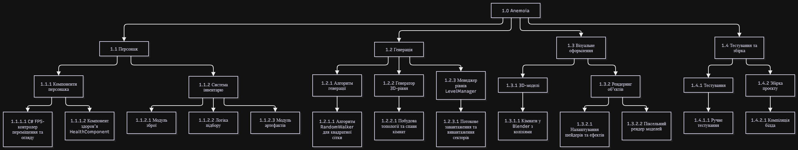

# Лабораторна робота 6
[*<- повернутися*](../README.md)

### Крок 1. Графічна побудова WBS на основі вимог

---

### Крок 2. Валідація пакетів робіт за "Правилом 8/80"
- Спрямування: Розробка, "Backend"
    1. 1.2.1.1
    2. Алгоритм RandomWalker для квадратної сітки
    3. 23 години
    4. Developer
- Спрямування: Управління
    1. 1.1.1.1
    2. Контролер переміщення та огляду
    3. 17 годин
    4. Developer
- Спрямування: Графіка та 3D
    1. 1.3.1.1
    2. Кімнати у Blender
    3. 29 годин
    4. 3D-художник
- Спрямування: QA
    1. 1.4.2.1
    2. Компіляція білда
    3. 4 годину
    4. DevOps 

---

### Крок 3. Складання Словника WBS (WBS Dictionary)

| Параметр Словника WBS                   | Пакет робіт №1 (Core Logic)                                                                                                                                                                 | Пакет робіт №2 (Gameplay)                                                                                                                                        |
| --------------------------------------- | ------------------------------------------------------------------------------------------------------------------------------------------------------------------------------------------- | ---------------------------------------------------------------------------------------------------------------------------------------------------------------- |
| Код та назва WBS:                       | 1.2.1.1 Алгоритм RandomWalker для квадратної сітки                                                                                                                                          | 1.1.1.1 Контролер переміщення та огляду                                                                                                                          |
| Батьківська User Story (Лаб №5):        | «Як гравець, я хочу унікальність структури рівнів кожну нову сесію, щоб була більша реіграбельність.»                                                                                       | «Як гравець, я хочу вільно переміщатися по ігровій локації у режимі від першої особи, щоб досліджувати рівень.»                                                  |
| Технічний опис задачі:                  | Написання класу `RandomWalker` у Godot. Генерація детермінованого 16-ричного зерна (seed), побудова матриці 13х13 від центральної позиції (6, 6) та алгоритмічне визначення позицій кімнат. | Реалізація переміщення від першої особи на вузлі `CharacterBody3D`: огляд мишею на 360, обробка ходьби, стрибків, гравітації та зіткнень із колізійними сітками. |
| Відповідальна роль:                     | Developer                                                                                                                                                                                   | Developer                                                                                                                                                        |
| Критерії завершення (DoD / Acceptance): | Алгоритм стабільно генерує прохідну матрицю 13х13 за заданим зерном, час генерації \<1 сек, відсутні безкінечні цикли при повторних спробах.                                                | Персонаж вільно переміщується без затримок, камера оглядає сцену на 360, колізійна сітка повністю блокує проходження крізь стіни.                                |
| Необхідні ресурси та залежності:        | Налаштоване середовище Godot, IDE, встановленний .NET                                                                                                                                       | Готова тестова сцена у Godot із підключеними колізіями підлоги та стін.                                                                                          |
| Оцінка трудомісткості:                  | 23 години                                                                                                                                                                                   | 17 годин                                                                                                                                                         |

---

### Контрольні запитання
1. У чому полягає суть “Правила 100%” при побудові WBS та як воно запобігає розширенню меж проєкту (Scope Creep)?
    Правила 100% полягає в тому, що WBS повинна включати 100% робіт, визначених обсягом проєкту, і нічого зайвого. Сума робіт дочірніх елементів кожного рівня повинна точно дорівнювати 100% батьківського вузла. Це запобігає Scope Creep, оскільки будь-яка задача, відсутня в WBS, вважається зайвою і не може бути додана без перегляду вимог.
2. Чому пакети робіт (Work Packages) не рекомендується дробити менше 8 годин або об’єднувати у блоки понад 80 годин?
	Дроблення задач менше ніж на 8 годин призводить до надмірного мікроменеджменту, оскільки витрати часу на контроль та звітність починають перевищувати час виконання задачі. Блоки задач понад 80 годин ускладнює оцінку ризиків, відстеження реального прогресу та виявлення проблем на ранніх етапах.
3. Чим відрізняється дерево WBS від організаційної структури команди (OBS) та від беклогу задач у Scrum?
    WBS структурує обсяг робіт і результати проєкту;
    OBS описує ієрархію та структуру команди4
    Scrum Backlog це пріоритезований список функцій та задач у часі, який постійно змінюється на відміну від базової структури WBS.
4. Яку роль відіграє Словник WBS (WBS Dictionary) у врегулюванні спорів щодо приймання робіт замовником?
    Словник WBS зафіксовує межі кожного пакета робіт, технічні вимоги, залежності та критерії готовності. У разі виникнення спорів чи виконана задача, словник WBS слугує документом, який показує, які саме результати підлягали здачі замовнику.