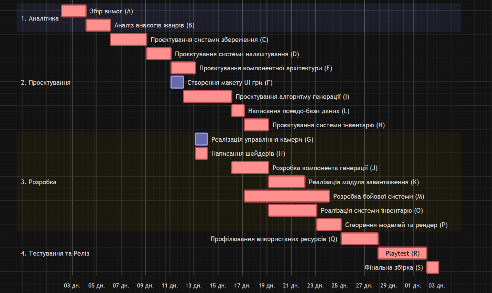

# Лабораторна робота 8
[*<- повернутися*](../README.md)

### Крок 1. Аналіз та визначення залежностей

| ID  | Назва задачі                                 | Тривалість (дні) | Попередники (Predecessors) |
| :-- | :------------------------------------------- | :--------------: | :------------------------- |
| A   | Збір вимог                                   |        2         | —                          |
| B   | Аналіз аналогів жанрів                       |        2         | A                          |
| C   | Проєктування системи збереження              |        3         | B                          |
| D   | Проєктування системи налаштування            |        2         | C                          |
| E   | Проєктування компонентної архітектури гравця |        2         | D                          |
| F   | Створення макету UI гри                      |        1         | D                          |
| G   | Реалізація управління камери гравця          |        1         | E                          |
| H   | Написання шейдерів                           |        1         | E                          |
| I   | Проєктування алгоритму процедурної генерації |        4         | H                          |
| J   | Розробка компонента процедурної генерації    |        3         | I                          |
| K   | Реалізація модуля завантаження даних з диска |        3         | J                          |
| L   | Написання псевдо-бази даних                  |        1         | K                          |
| M   | Розробка бойової системи                     |        7         | L                          |
| N   | Проєктування системи інвентарю               |        2         | M                          |
| O   | Реалізація системи інвентарю                 |        4         | N                          |
| P   | Створення стилізованих моделей та рендер     |        2         | O                          |
| Q   | Профілювання використаних ресурсів           |        3         | P                          |
| R   | Playtest                                     |        4         | Q                          |
| S   | Фінальна збірка                              |        1         | R                          |

---

### Крок 2. Побудова Діаграми Ганта

---

### Крок 3. Визначення Критичного шляху (Critical Path / CPM)
- Послідовність Критичного шляху (ID задач): `A -> B -> C -> D -> E -> H -> I -> J -> K -> L -> M -> N -> O -> P -> Q -> R -> S`
- Загальна тривалість проєкту: 368 робочих годин

---

### Контрольні запитання
1. Поясніть своїми словами, що таке “Залежність Finish-to-Start (FS)”. Наведіть приклад з реального життя (не з IT)?
    Неможна заносити нові меблі або клеїти шпалери, коли у кімнаті тільки почали штукатурити.
2. Що таке “Критичний шлях” (Critical Path) на Діаграмі Ганта і чому Project Manager повинен слідкувати за задачами на ньому щодня?
	Критичний шлях – це найдовший за сумарним часом ланцюг залежних задач від початку до кінця проєкту; визначає мінімально можливий термін його завершення. PM повинен щодня контролювати задачі критичного шляху, оскільки вони мають бути зроблені вчасно, інакше зрив дедлайну.
3. Чи можлива ситуація, коли в проєкті існує відразу ДВА паралельних критичних шляхи? Що це означає для ризиків проєкту?
    Можлива, якщо обидва критичних шляха мають однаковий час виконання.
	Чим більше критичних шляхів – у стільки ж подвоюється ризик. 
4. Якщо задача “Копірайтинг” не лежить на критичному шляху і має “Резерв часу” (Float) у 3 дні, що станеться з фінальною датою релізу проєкту, якщо копірайтер запізниться зі здачею текстів на 2 дні?
    Фінальна дата релізу проєкту не зміниться, бо копірайтер вклався у строк. 
5. Чому Діаграму Ганта практично неможливо і неефективно використовувати для управління інноваційними стартапами, які розробляються за методологією Scrum?
    Філософія Ганта та Скрама відрізняються: діаграма вимагає заздалегідь зафіксованого обсягу робіт та жорстких залежностей між ними, а у Scrum вимоги постійно змінюються за результатами спринтів та зворотного зв'язку від ринку.
