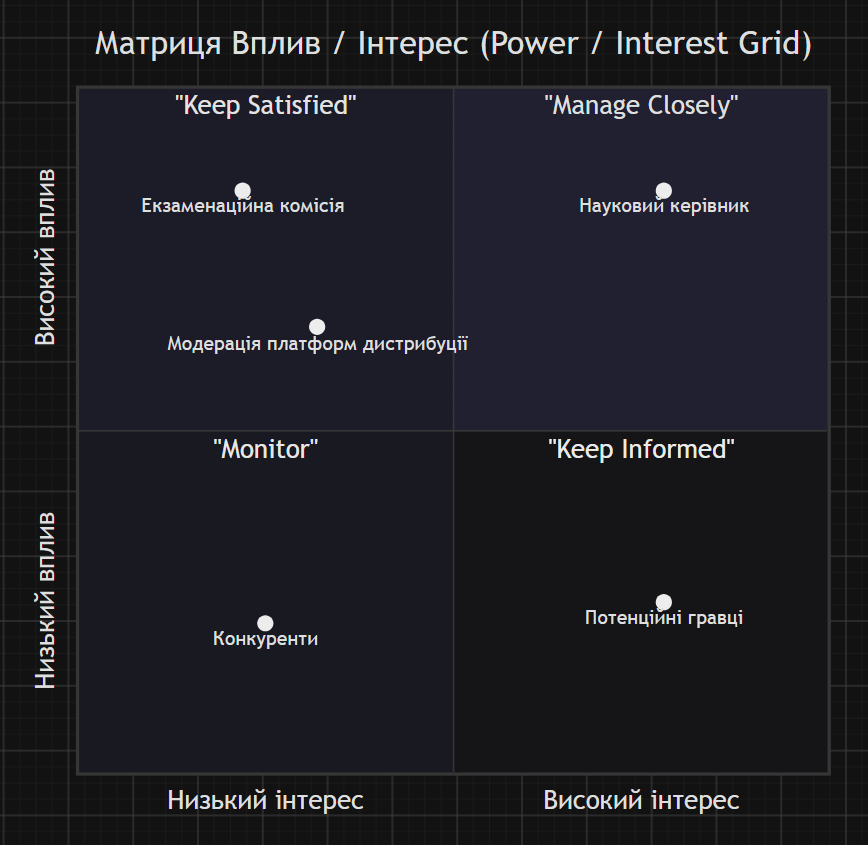

# Лабораторна робота 13
[*<- повернутися*](../README.md)

---

### Крок 1. Ідентифікація стейкхолдерів
- Науковий керівник – контролює дотримання розробки, консультує щодо технічної реалізації і оформлення квалфікаційної роботи.
- Екзаменаційна комісія – не цікавляться деталями геймплею, але оцінюють відповідність роботи академічним вимогам та технічній реалізації, а також виставляють фінальну оцінку на захисті.
- Потенційні гравці – тестують проміжні білди гри, повідомляють про баги та чекають на реліз, але не приймають управлінських рішень.
- Модерація платформ дистрибуції – не стежить за процесом створення гри, проте можуть заблокувати сторінку або зняти білд з публікації у разі порушення правил.
- Конкуренти – не впливають на розробку напряму, але формують очікування аудиторії та виступають орієнтиром якості в жанрі.

---

### Крок 2. Побудова Матриці Вплив/Інтерес

---

### Крок 3. Розробка Плану комунікацій

| Стейкхолдер                  | Інформація (Що повідомляємо)                                                                           | Формат та Канал                                                                           | Частота                                               | Відповідальний     |
| :--------------------------- | :----------------------------------------------------------------------------------------------------- | :---------------------------------------------------------------------------------------- | :---------------------------------------------------- | :----------------- |
| 1. Науковий керівник         | Статус написання проєкту, демонстрація проміжних результатів, узгодження розділів та технічних рішень. | Листування; очна консультація або у Discord.                                              | Раз на 1–2 тижні.                                     | Виконавець проєкту |
| 2. Екзаменаційна комісія  | Завершена пояснювальна записка, презентація та демонстрація стабільної фінальної збірки гри.           | Роздрукована кваліфікаційна робота, презентація.                                          | Одноразово на фінальному етапі (передзахист і захист) | Виконавець проєкту |
| 3. Потенційні гравці         | Список оновленого, опис змін, доступ до нових збірок, збір фідбеку та баг-репортів.                    | Публікація білдів та постів на сторінці гри в Itch.io, обговорення в Telegram чи Discord. | Після кожного великого оновлення                      | Виконавець проєкту |

---

## Контрольні запитання